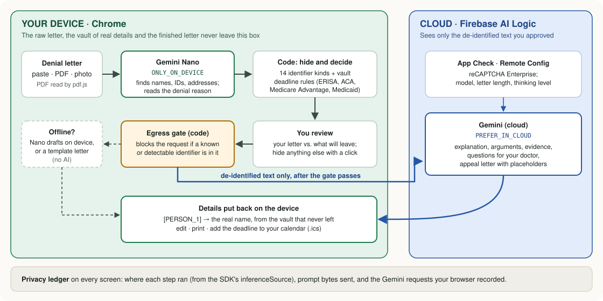
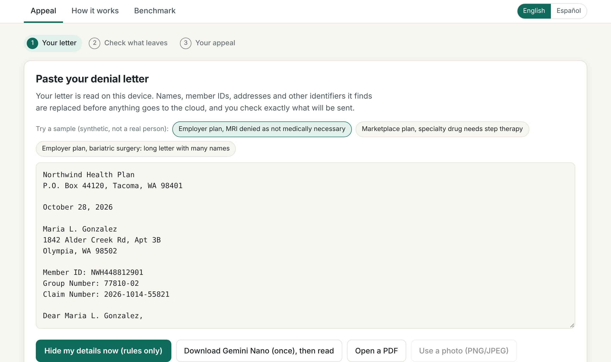
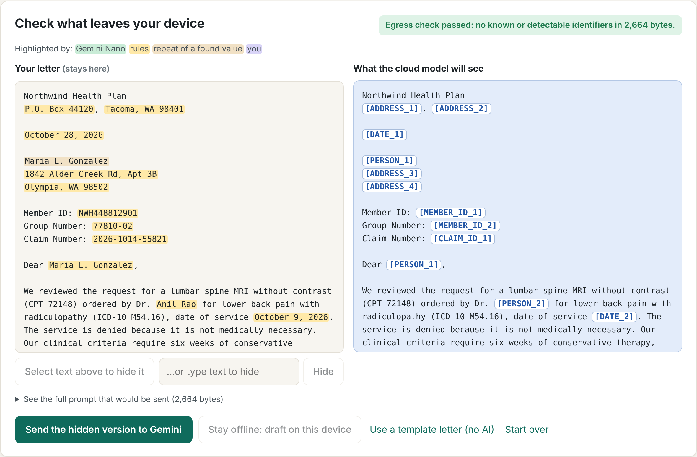
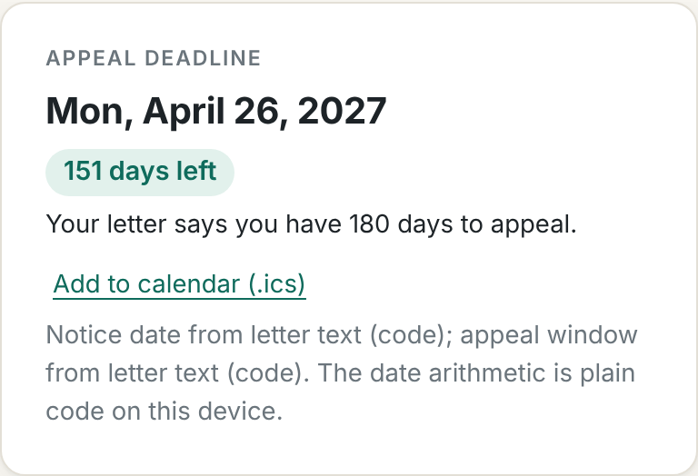
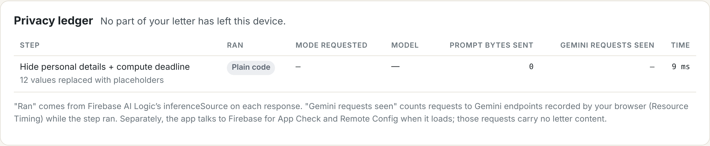
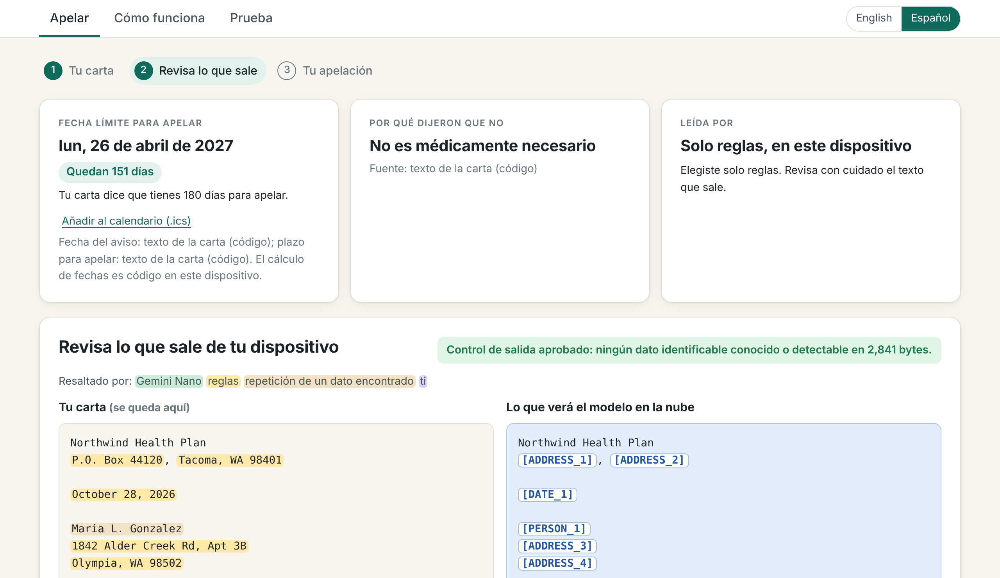

# Overturn

**Appeal a health insurance denial. Your identity stays on your device.**

   

Overturn is a web app for #BuildHybridAI 2026 built on **Firebase AI Logic hybrid inference**.
Gemini Nano reads the denial letter **in Chrome, on the patient's device**. Code replaces
every name, member ID, address and date it finds, you check the result, and a code gate blocks
anything it still recognises. **Only that de-identified text goes to Gemini in the cloud**, which
writes the appeal. The real details are filled back in on the device.

- **Live app:** https://acirema792.github.io/overturn/ · **Demo video:** _added at submission_
- **Review in five minutes:** [JUDGES.md](JUDGES.md) · **Measured results:** [BENCHMARK-RESULTS.md](BENCHMARK-RESULTS.md) · **Claims and evidence:** [CLAIMS.md](CLAIMS.md) · **SDK feedback:** [FEEDBACK.md](FEEDBACK.md)
- **Input:** paste the letter, open a **PDF** (read on the device with pdf.js), or a photo (Gemini Nano transcribes it on the device). **Languages:** English and **Español** (the explanation is in Spanish; the appeal letter stays in English for the US insurer).



| Your letter, with the identifiers found | What leaves vs. what stays |
|---|---|
|  |  |
| **The deadline, computed by code** | **Privacy ledger** |
|  |  |

<details><summary>En español</summary>



</details>

<sub>Screenshots: the real production build on the rules-only path (headless Chromium has no Gemini Nano), synthetic sample letter, cropped below the status bar. Regenerate with `npm run build && node scripts/screenshots.mjs`.</sub>

## Why

In 2024, insurers on HealthCare.gov denied **19% of in-network claims**, and **fewer than 1% of
denials were appealed** ([KFF, March 2026](https://www.kff.org/private-insurance/claims-denials-and-appeals-in-aca-marketplace-plans-in-2024/)).
Appeals are hard to write, the deadline is buried in the letter, and the obvious helper, a cloud
chatbot, asks you to paste in your name, member ID, date of birth and diagnosis.

The appeal needs the **medicine** (what was denied and why). It doesn't need the **identity**.
That split is exactly what hybrid inference is for.

## How it works

| Step | Where | Firebase AI Logic mode | Why this mode |
|---|---|---|---|
| 1. Read the letter (pasted, a PDF read on the device by pdf.js, or a photo): find every person, ID, address, contact; read the denial reason | Gemini Nano in Chrome | `ONLY_ON_DEVICE` + our own availability check first | `PREFER_ON_DEVICE` would silently fall back to the cloud when Nano isn't ready, which would upload the raw letter. And in SDK 13.4.0, even `ONLY_ON_DEVICE` goes to the cloud when Chrome lacks the Prompt API ([FEEDBACK.md](FEEDBACK.md)), so we check first and fail closed. |
| 2. Replace identifiers with placeholders (`[PERSON_1]`, `[MEMBER_ID_1]`); compute the appeal deadline | Plain code on the device | none | Deterministic rules for 14 identifier kinds, plus every value Nano found, everywhere it appears. The deadline arithmetic is code: the window the letter states, or the federal minimum (ERISA 180 days, Medicare Advantage 65, Medicaid 60). If code can't find the notice date or window, Gemini Nano's reading is used and the deadline card says so. |
| 3. Egress gate + the patient's approval | Plain code on the device | none | The request is blocked if any known identifier (even reformatted) or any detectable new one is in the outgoing text. The patient sees the exact text and approves it. |
| 4. Write the explanation, arguments and appeal letter | Gemini in the cloud | `PREFER_IN_CLOUD` | The stronger model does the hard writing from de-identified text. If the network fails, the SDK falls back to Gemini Nano. |
| 4b. "Stay offline" | Gemini Nano | `ONLY_ON_DEVICE` | The patient can keep everything local. |
| 5. Fill the real details back in | Plain code on the device | none | The cloud never sees the finished letter. |

Every step is recorded in an on-screen **privacy ledger**: where it ran (from the SDK's
`inferenceSource`), bytes sent, and the number of requests to Gemini endpoints the browser
recorded during the step.

## Built on Firebase

| Product | Job in Overturn |
|---|---|
| **Firebase AI Logic** (Web SDK, hybrid) | Two inference modes, chosen per step: `ONLY_ON_DEVICE` (raw letter, photo, offline draft) and `PREFER_IN_CLOUD` (redacted appeal). Structured JSON output on both paths from one schema (`responseConstraint` on device, `responseJsonSchema` in the cloud). |
| **Gemini Nano in Chrome** (via AI Logic) | Finds identities, reads the denial, transcribes photos, drafts offline. |
| **Gemini Developer API** (via AI Logic) | Writes the appeal from de-identified text. |
| **App Check** | Required by AI Logic: only this app can call Gemini through the project. |
| **Remote Config** | Switches the cloud model and the appeal letter's word limit without a release. |

## Measured results

Run `npm run eval` (rules-only layer, in Node) or open **Benchmark** in the app (adds Gemini Nano,
in your own Chrome). Letters are synthetic; expected answers were written before the runs.

| | Paste into a chatbot | Overturn, rules only, **held-out** letters |
|---|---|---|
| Identifiers that would reach the cloud | 34/34 | **7/34** (all names: after labels the rules don't use, like "Recipient:", or in running text) |
| Clinical facts kept for the appeal | 23/23 | **23/23** |
| Appeal deadline correct | n/a | **8/8** (including "unknown: we won't guess") |

The rules-only numbers are the floor for browsers without Gemini Nano. The remaining misses are
names our rules don't catch (after labels they don't use, like "Recipient:", or in running text such as "for Nadia Haddad"), which is the job of
the on-device model and of the review screen. Full tables and the tuning set:
[BENCHMARK-RESULTS.md](BENCHMARK-RESULTS.md). The Gemini Nano run is not recorded yet; you can run
it yourself in the app's Benchmark tab in desktop Chrome.

## Honest limits

- No detector is perfect. That is why the patient reviews the outgoing text, with one-click hiding.
- The medical content does go to the cloud model, because the appeal is about it. Identity does not.
- Deadlines use federal minimums when the letter doesn't state one; state law and plan documents can
  differ. The app says when it used a default, and says "not sure" rather than guess.
- Not legal or medical advice.

## Run it yourself

```bash
npm ci
npm test          # 263 unit, pipeline, engine (SDK mocked), Spanish UI and adversarial tests
npm run build && npm run e2e   # 9 Playwright UI checks (simulated engine; PDF, Español, 390px; run `npx playwright install chromium` once)
npm run eval      # rules-only benchmark (prints; `npm run eval:write` updates eval_results/)
npm run dev       # needs .env.local (see .env.example) for real models
```

Without Firebase settings, open `http://localhost:5173/?engine=sim` for a **simulated** UI (no model
runs; a banner says so on every screen).

**Firebase setup:** create a project, enable **AI Logic** with the Gemini Developer API, register a
Web app, copy its config into `.env.local`, and set up App Check (reCAPTCHA Enterprise for the
deployed domain; `VITE_APPCHECK_DEBUG=true` locally, then register the printed debug token). For
Gemini Nano, use desktop Chrome 139+; for photos, enable
`chrome://flags/#prompt-api-for-gemini-nano-multimodal-input`.

**CI:** pushes to `main` run lint, tests, the benchmark, the build and the Playwright UI test
(`.github/workflows/deploy.yml`).

**Deploy:** `npm run deploy:pages` builds with the Firebase web config from a git-ignored
`.env.production.local` and publishes `dist/` to the `gh-pages` branch (GitHub Pages). The web
config is public by design (it ships in every Firebase web app); App Check (reCAPTCHA Enterprise)
protects the project, and `main` contains no keys.

## Project layout

```
src/core/        detectors, redaction vault, egress gate, deadline rules, template letter (pure, tested)
src/ai/          Firebase AI Logic engine, prompts, JSON schemas, simulated engine for UI tests
src/pipeline.ts  read on device → redact → facts (code first, model second) → cloud prompt
src/data/        synthetic evaluation letters (tuning set + held-out set)
src/components/  appeal flow, privacy ledger, benchmark, how it works
src/pdf/         on-device PDF text extraction (pdf.js, loaded only when a PDF is opened)
src/i18n.ts      English and Spanish UI text
```

Built during #BuildHybridAI 2026 (Nov 11–30, 2026). Apache-2.0.
